# WgStatusGo v2.5


-2563EB)


-FF6384?logo=chartdotjs&logoColor=white)

**WgStatusGo** is an ultra-lightweight, single-binary real-time web dashboard and telemetry server for WireGuard VPN gateways, written in Go.

Compiled with `CGO_ENABLED=0` and `//go:embed`, **WgStatusGo** bundles the entire backend telemetry engine, Netlink kernel collector, Excel/CSV report generator, and responsive frontend (HTML, CSS, vanilla JS, and Chart.js 4.5.1) into a single static executable requiring **< 8 MB of RAM**, **< 5ms startup time**, and **zero runtime dependencies** on your Linux server.

> [!NOTE]
> **Looking for the Python/Flask edition?** See the companion **WgStatus (Python)** repository. Both editions share 100% REST/WebSocket API parity, identical JSON persistence schemas, and the same hardened web UI. For internal Go design details, see [ARCHITECTURE.md](./ARCHITECTURE.md).

---

## 📸 Screenshots

### Dark Mode — Online Peers & Live Telemetry
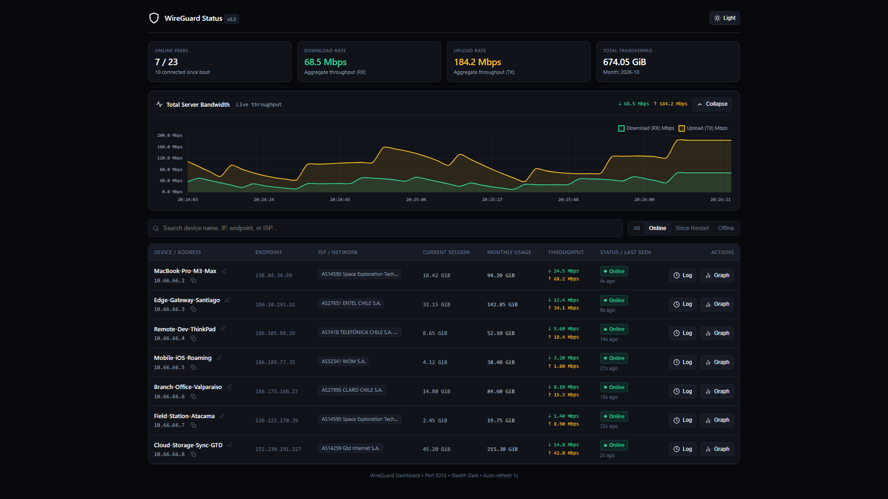

### Dark Mode — All Configured Peers & Extended Peer Cards
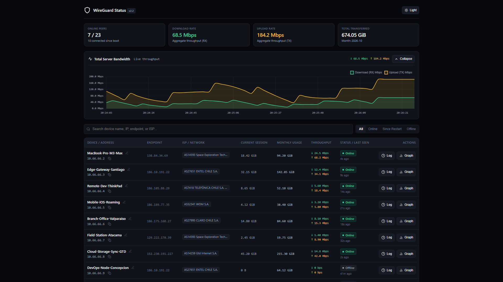
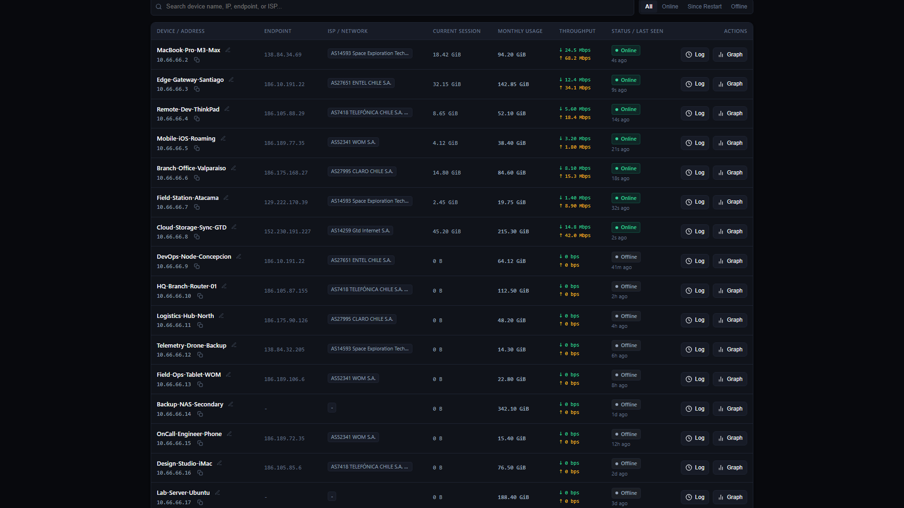

### Session History & Monthly Telemetry Modal
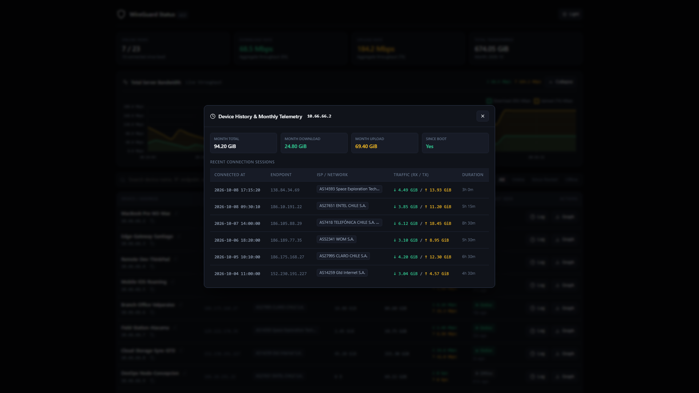

### Live Per-Peer Bandwidth Chart
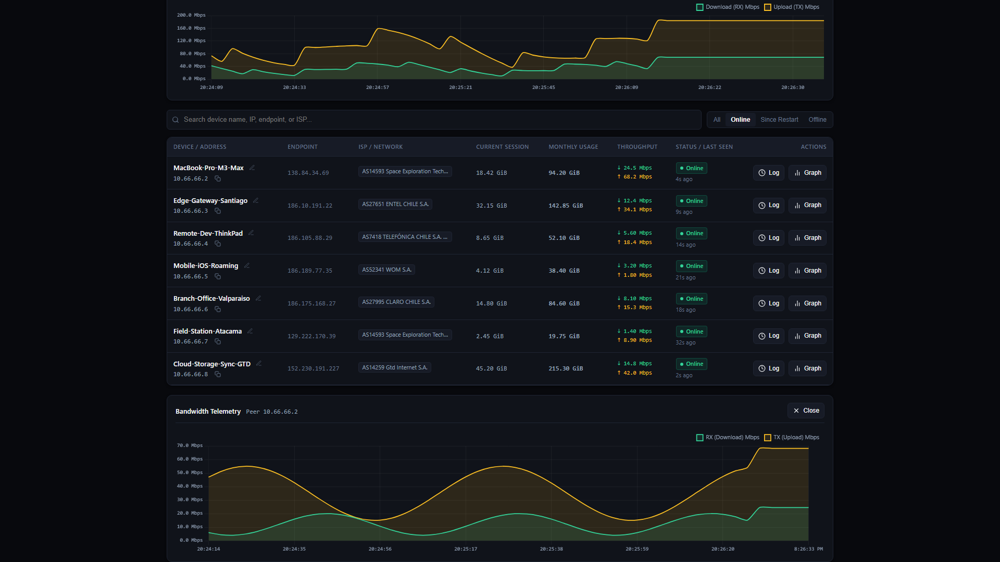

### Instant Search & ISP Filtering (`Starlink` / `Entel`)
| Filter by ISP: Starlink | Filter by ISP: Entel |
| :---: | :---: |
| 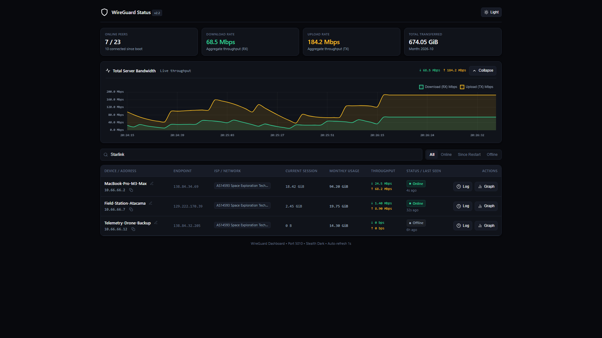 | 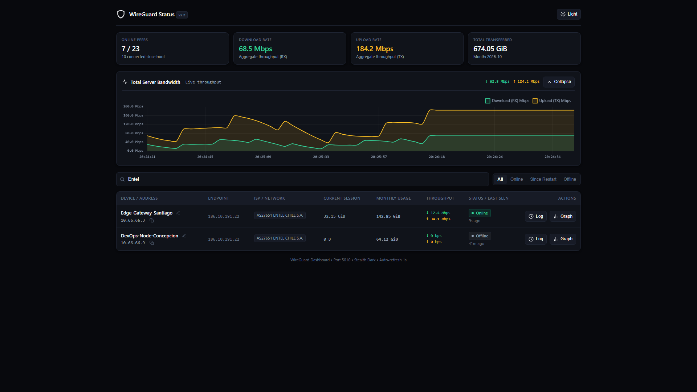 |

### "Connected Since Restart" Filter & Custom Peer Nickname Editor
| Connected Since Restart Filter | Custom Peer Nickname Modal |
| :---: | :---: |
| 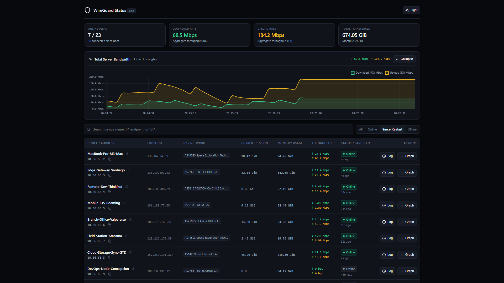 | 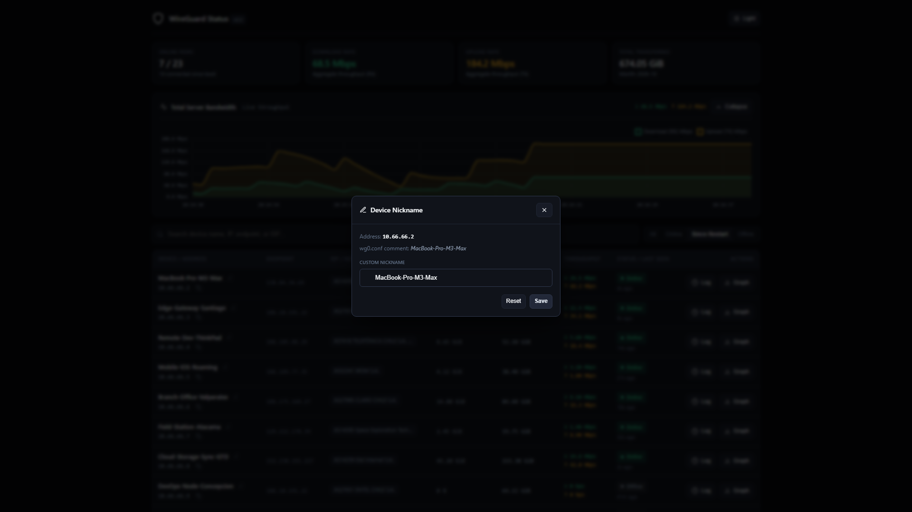 |

### Light Mode Views
| Online Peers (Light Mode) | All Peers (Light Mode) |
| :---: | :---: |
| 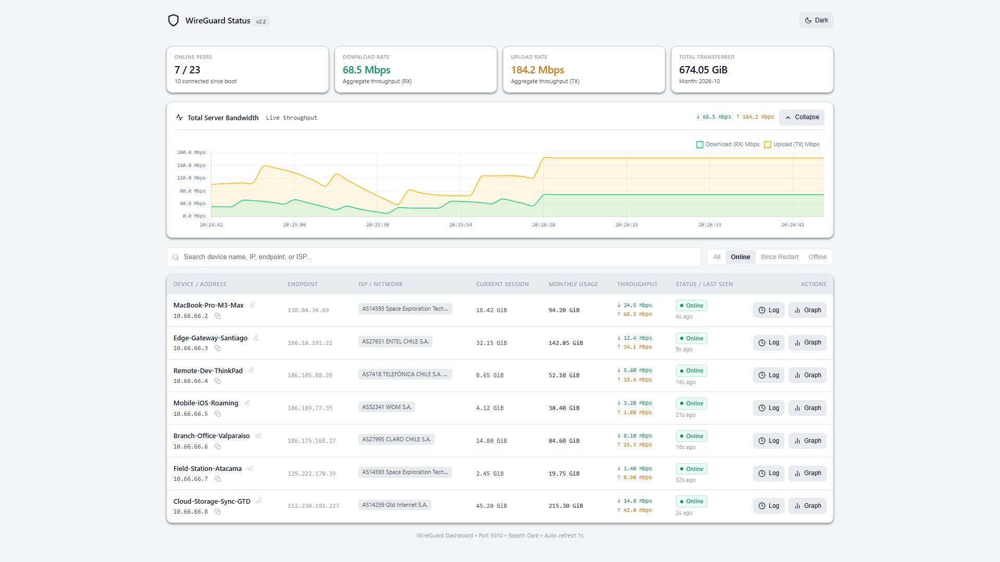 | 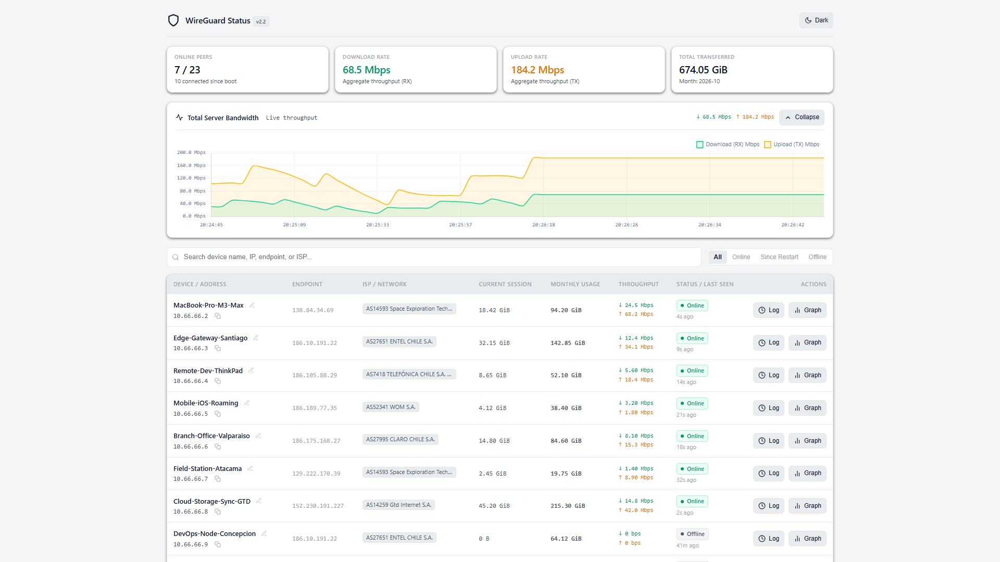 |

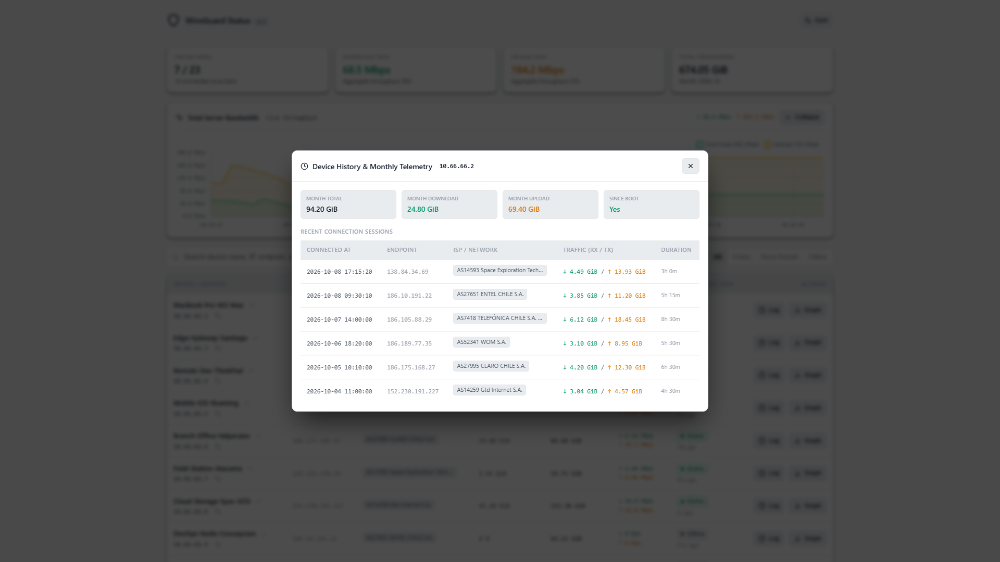

---

## 🏗️ System Architecture

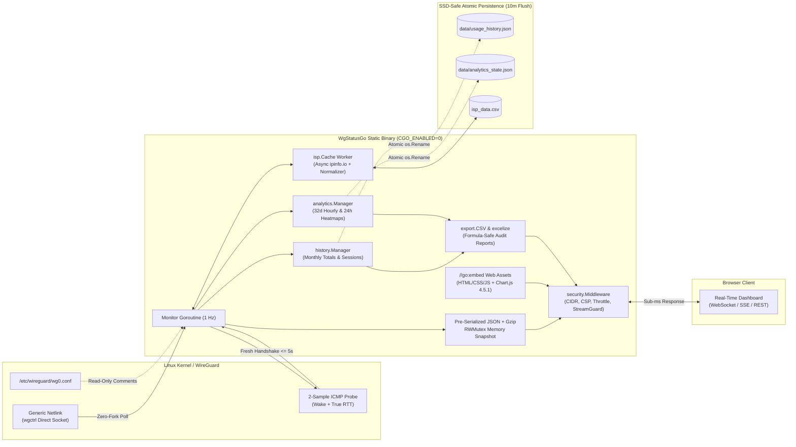

---

## ✨ Key Highlights

### ⚡ Native Go Performance & Single Static Binary
- **Zero External Dependencies**: Compiled with `CGO_ENABLED=0` and `//go:embed`. Deploy a single binary to any Linux distro (Debian, Ubuntu, Alpine, Arch, OpenWrt, Raspberry Pi OS) without installing Python, pip, or Node.js.
- **Direct Kernel Netlink (`wgctrl`)**: Reads peer states, handshakes, and exact 64-bit byte counters directly from the Linux kernel via `golang.zx2c4.com/wireguard/wgctrl`—eliminating periodic subprocess forks. Automatically falls back to realistic mock telemetry on Windows/macOS development machines.
- **Sub-Millisecond Pre-Compressed Cache**: The 1 Hz background monitor pre-serializes and Gzip-compresses `/status`, `/summary`, and `/api/live` payloads in memory. Concurrent HTTP, SSE, and WebSocket viewers are served from RAM in `< 0.2ms` with zero lock contention.
- **Minimal Footprint**: Consumes `< 8 MB` of resident RAM under load and starts in `< 5ms`.

### 🛡️ Enterprise Web Hardening & Security
- **Subnet Access Control (`WG_ALLOWED_NETWORKS`)**: Restrict dashboard access to specific IPv4/IPv6 CIDR blocks (e.g. `10.0.0.0/8,192.168.1.0/24`). Unauthorized subnets receive an immediate HTTP 403.
- **Trusted Proxy Hop Resolution (`WG_TRUSTED_PROXIES`)**: Safely walks `X-Forwarded-For` right-to-left only when the immediate peer belongs to a trusted reverse proxy subnet, preventing IP spoofing and rate-limit bypasses.
- **Host & Origin Enforcement**: Whitelists `Host` headers (`WG_ALLOWED_HOSTS`) and validates `Origin` / `Sec-Fetch-Site` headers on all state-changing requests and WebSocket upgrades (`/ws`) to block DNS rebinding, CSRF, and cross-site WebSocket hijacking.
- **Strict Content Security Policy (CSP)**: Serves strict security headers (`default-src 'self'`, `script-src 'self'`, `frame-ancestors 'none'`, `X-Content-Type-Options: nosniff`, `X-Frame-Options: DENY`, `Referrer-Policy: no-referrer`, and HSTS over HTTPS).
- **Brute-Force Protection (`LoginThrottle`)**: Enforces constant-time SHA-256 password verification (`subtle.ConstantTimeCompare`), per-IP exponential lockouts (60s doubling up to 1h after 5 failed attempts), and a global failure ceiling to stop distributed botnet guessing.
- **Sliding-Window Rate Limiters & `StreamGuard`**: Separate per-IP sliding-window buckets for general (`600/min`), heavy export/analytics (`20/min`), and write (`30/min`) endpoints, plus `StreamGuard` concurrency caps on long-lived WebSocket/SSE streams.
- **RAM-Only Bearer Sessions**: Stores only SHA-256 digests of cryptographically random 32-byte session tokens in memory, delivered via `HttpOnly; SameSite=Strict` cookies.

### 📊 32-Day ISP Analytics, Session History & SSD Protection
- **32-Day Hourly Traffic Retention**: Records 768 rolling hourly buckets of RX/TX bytes, peak bitrates, online peer counts, and per-ISP breakdowns, plus 24-hour (`00:00–23:00`) activity heatmaps.
- **Asynchronous ISP Resolution & Normalization**: Immediately tags RFC 1918 / CGNAT addresses as `INTERNAL` and resolves public endpoints asynchronously via `ipinfo.io` worker goroutines, stripping ASN prefixes and normalizing carrier names in `isp_data.csv`.
- **Battery-Safe 2-Sample ICMP Ping Engine**: Triggers a non-blocking 2-packet ping burst only when a peer completes a fresh WireGuard handshake (`<= 5s`) or roams to a new endpoint/ISP—waking sleeping mobile radios on the first probe and capturing true RTT on the second without draining client batteries.
- **SSD Wear Protection**: Buffers high-frequency telemetry in RAM and flushes atomically (`.tmp` write + `os.Rename`) every 10 minutes (`WG_FLUSH_INTERVAL=600`), on manual `/api/flush`, and on graceful `SIGINT`/`SIGTERM` shutdown, with automatic `.gz` monthly archiving.
- **Formula-Safe CSV & Multi-Sheet Excel (`excelize`) Exports**: Generates UTF-8 BOM CSVs and styled `.xlsx` executive audit workbooks (Peers, Sessions, Monthly History, and ISP Analytics sheets) while neutralizing spreadsheet formula injection (`=`, `+`, `-`, `@`).

---

## 📂 Project Structure

```text
WgStatusGo/
├── cmd/
│   └── wgstatus/
│       └── main.go                 # Application entrypoint, CLI flags & graceful shutdown
├── internal/
│   ├── analytics/                  # 32-day hourly traffic buckets, 24h heatmaps & ISP rankings
│   ├── config/                     # Environment variable loader & CIDR/host parsers
│   ├── export/                     # Formula-safe CSV & styled multi-sheet Excel (excelize) exports
│   ├── history/                    # Monthly byte accounting, session logs, aliases & .gz archives
│   ├── isp/                        # Async ipinfo.io resolver, ASN normalizer & CSV cache
│   ├── ping/                       # Battery-safe 2-sample ICMP latency prober
│   ├── security/                   # Middleware, CSP, LoginThrottle, SlidingWindowLimiter & StreamGuard
│   ├── server/                     # 1 Hz WireGuard monitor, Chi router, REST/SSE/WebSocket handlers
│   └── wireguard/                  # Linux wgctrl Netlink client, wg0.conf parser & mock generator
├── web/
│   ├── embed.go                    # //go:embed directive bundling templates/* and static/*
│   ├── templates/index.html        # Responsive dashboard UI (Dark & Light modes)
│   └── static/                     # CSS, vanilla JS modules & vendored Chart.js 4.5.1
├── screenshots/                    # Dashboard UI previews (Dark & Light modes)
├── ARCHITECTURE.md                 # Detailed Go architecture & technical specification
├── go.mod
└── go.sum
```

---

## 🚀 Build & Cross-Compilation

### Prerequisites
- **Go 1.22+** (to build from source)
- Zero runtime dependencies on the target server

### Build Commands

```bash
# 1. Clone the repository
git clone <repository-url>
cd WgStatusGo

# 2. Build for Linux amd64 (static binary, stripped symbols)
GOOS=linux GOARCH=amd64 CGO_ENABLED=0 go build -ldflags="-s -w" -o wgstatus ./cmd/wgstatus

# 3. Build for Linux ARM64 (Raspberry Pi 4/5, AWS Graviton, ARM gateways)
GOOS=linux GOARCH=arm64 CGO_ENABLED=0 go build -ldflags="-s -w" -o wgstatus-arm64 ./cmd/wgstatus

# 4. Build for Windows amd64 (runs in automatic Demo/Mock mode for UI preview)
GOOS=windows GOARCH=amd64 CGO_ENABLED=0 go build -ldflags="-s -w" -o wgstatus.exe ./cmd/wgstatus
```

### Run Directly / CLI Flags
```bash
# Run on default port 5010 (auto-detects wg0 on Linux, or Mock Mode on Windows/macOS)
./wgstatus

# Override port, WireGuard interface, or force demo mock mode via CLI flags
./wgstatus -port 8080 -device wg0
./wgstatus -mock
```

---

## ⚙️ Production Deployment (`systemd`)

1. Copy the compiled `wgstatus` binary to `/opt/wgstatus/wgstatus`:
   ```bash
   sudo mkdir -p /opt/wgstatus/data /opt/wgstatus/archives
   sudo cp wgstatus /opt/wgstatus/wgstatus
   sudo chmod +x /opt/wgstatus/wgstatus
   ```

2. Create `/etc/default/wgstatus` with your security configuration:
   ```bash
   SERVER_PASSWORD="your-strong-admin-password"
   PORT="5010"
   WG_DEVICE="wg0"
   WG_ALLOWED_NETWORKS="10.0.0.0/8,192.168.1.0/24"
   WG_PROTECT_WRITES="true"
   ```

3. Create `/etc/systemd/system/wgstatus.service`:
   ```ini
   [Unit]
   Description=WgStatusGo - WireGuard Telemetry & Status Dashboard
   After=network-online.target
   Wants=network-online.target

   [Service]
   Type=simple
   User=root
   WorkingDirectory=/opt/wgstatus
   EnvironmentFile=-/etc/default/wgstatus
   ExecStart=/opt/wgstatus/wgstatus
   Restart=on-failure
   RestartSec=3

   [Install]
   WantedBy=multi-user.target
   ```

4. Enable and start the service:
   ```bash
   sudo systemctl daemon-reload
   sudo systemctl enable --now wgstatus
   sudo systemctl status wgstatus
   ```

---

## 🔌 API Endpoints

| Endpoint | Method | Auth | Description |
|---|---|---|---|
| `/` | `GET` | Public | Main interactive dashboard (served from embedded filesystem) |
| `/status` | `GET` | Public | List of all peers with live status, speeds, ping RTT, and total transfer |
| `/summary` | `GET` | Public | Aggregate overview (active peer count, total speeds, total transfer) |
| `/bandwidth` | `GET` | Public | Real-time byte counters and instant transfer rates |
| `/bandwidth/history?ip=<ip>` | `GET` | Public | Historical time-series points (Mbps) for a given peer or `total` |
| `/api/live` | `GET` | Public | Combined live telemetry payload (`peers` + `summary`) |
| `/api/stream` | `GET` | Public | Server-Sent Events (SSE) stream for live updates (guarded by `StreamGuard`) |
| `/ws` | `WS` | Public | WebSocket telemetry stream (guarded by `StreamGuard`) |
| `/api/history?ip=<ip>` | `GET` | Public | Persistent monthly telemetry and recent connection session logs |
| `/api/analytics` | `GET` | Public | Busiest hours, 24h pattern, and ISP rankings (`?range=24h\|7d\|30d\|all`) |
| `/api/auth/login` | `POST` | Public | Authenticate password; sets secure `HttpOnly` session cookie |
| `/api/auth/status` | `GET` | Public | Check if current session cookie is valid |
| `/api/auth/logout` | `POST` | Public | Invalidate session cookie |
| `/api/alias` | `POST` | Required | Set or clear a peer's custom nickname |
| `/api/flush` | `POST` | Required | Force immediate atomic write of buffered telemetry to disk |
| `/api/export/peers` | `GET` | Required | Export configured peers (`?format=csv\|xlsx`) |
| `/api/export/sessions` | `GET` | Required | Export peer connection sessions (`?format=csv\|xlsx&ip=<ip>`) |
| `/api/export/analytics` | `GET` | Required | Export network traffic analytics (`?format=csv\|xlsx&range=...`) |
| `/api/export/report` | `GET` | Required | Full multi-sheet executive audit workbook (`?format=xlsx`) |
| `/health` | `GET` | Public | Health check endpoint returning `{ "status": "ok" }` |

*Note: Automated scripts or `curl` clients calling protected endpoints can authenticate via the `X-Server-Password: <password>` header.*

---

## 🔧 Environment Variables

| Variable | Default | Description |
|---|---|---|
| `PORT` | `5010` | TCP port for the HTTP server to bind |
| `HOST` | `0.0.0.0` | Network interface address to bind |
| `WG_DEVICE` | `wg0` | WireGuard kernel interface name queried via Netlink |
| `WG_CONF_FILE` | *(auto)* | Optional path to `wg0.conf` for read-only peer comment extraction |
| `SERVER_PASSWORD` | *(default notice)* | Master password for dashboard authentication and write/export endpoints |
| `SERVER_PASSWORD_FILE` | *(none)* | File path to read master password from (ideal for Docker/systemd secrets) |
| `WG_ALLOW_DEFAULT_PASSWORD` | `true` | Set to `false` to disable login completely until `SERVER_PASSWORD` is configured |
| `WG_PROTECT_WRITES` | `true` | Require authentication for exports, nickname edits (`/api/alias`), and `/api/flush` |
| `WG_ALLOWED_NETWORKS` | *(all)* | Comma-separated CIDR subnets allowed to access the server (e.g. `10.0.0.0/8,192.168.1.0/24`) |
| `WG_TRUSTED_PROXIES` | *(none)* | Comma-separated proxy IPs/CIDRs trusted to supply `X-Forwarded-For` / `X-Forwarded-Proto` |
| `WG_ALLOWED_HOSTS` | *(all)* | Comma-separated allowed `Host` header values |
| `WG_ALLOWED_ORIGINS` | *(all)* | Comma-separated allowed `Origin` values for cross-origin requests |
| `WG_RATE_LIMIT_GLOBAL` | `600` | Max requests per minute per IP for general endpoints |
| `WG_RATE_LIMIT_HEAVY` | `20` | Max requests per minute per IP for heavy endpoints (analytics, exports) |
| `WG_RATE_LIMIT_WRITE` | `30` | Max requests per minute per IP for write endpoints (login, alias, flush) |
| `WG_LOGIN_MAX_ATTEMPTS` | `5` | Failed login attempts within `600s` before IP lockout activates |
| `WG_LOGIN_LOCKOUT` | `60` | Initial IP lockout duration in seconds |
| `WG_LOGIN_MAX_LOCKOUT` | `3600` | Maximum exponential IP lockout duration in seconds (1 hour) |
| `WG_LOGIN_GLOBAL_MAX` | `40` | Global failed login ceiling across all IPs before pausing logins |
| `WG_MAX_STREAMS_PER_IP` | `6` | Maximum concurrent streaming connections (SSE / WebSocket) per IP |
| `WG_MAX_STREAMS_TOTAL` | `150` | Global maximum concurrent streaming connections |
| `WG_POLL_INTERVAL` | `1.0` | Polling interval in seconds for WireGuard telemetry |
| `WG_FLUSH_INTERVAL` | `600` | RAM buffer flush interval to disk in seconds (default 10 min) |
| `WG_DATA_DIR` | `data` | Directory for persistent JSON telemetry state files |
| `WG_ISP_CACHE_FILE` | `isp_data.csv` | Filepath for cached IP-to-ISP mappings |
| `WG_PING_ENABLED` | `true` | Enable or disable battery-safe client ICMP ping measurement |
| `WG_PING_MAX_HANDSHAKE_AGE` | `5.0` | Max handshake age in seconds to trigger a one-time ping check |
| `WG_PING_TIMEOUT` | `2.0` | ICMP ping response timeout in seconds |
| `WG_MOCK` | `false` (auto) | Set to `1` or `true` to force demo mock telemetry |
